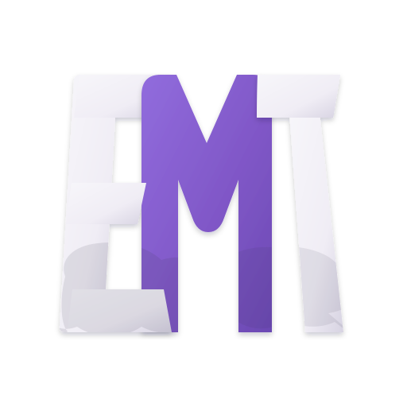
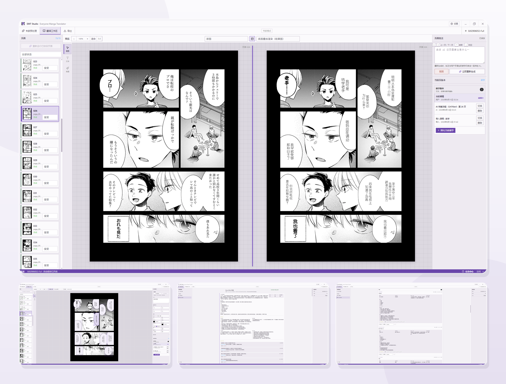

# EMT Studio

[English](README.md) | [简体中文](README.zh-CN.md)

<p align="center">
  
</p>

**Translate with the whole story in mind.**

EMT Studio is a desktop workspace for translating and lettering manga. Instead
of treating every speech bubble as an isolated sentence, it can first build
book-wide context from characters, relationships, terminology, scenes, and
story clues, then carry that context through translation and review.

From importing a folder or PDF to cleaning the original text, laying out the
translation, reviewing each page, and exporting the finished book, EMT Studio
keeps the entire process in one editable local project. It is designed for
translators, scanlation teams, and creators who want AI assistance without
giving up control over the final result.

<p align="center">
  
</p>

> [!WARNING]
> EMT Studio is under active development. Keep backups of source material and
> project data. Only process and distribute content that you are authorized to
> use.

> [!IMPORTANT]
> EMT Studio is currently developed and tested primarily by Simplified Chinese
> speakers. Workflows that translate into other target languages have not yet
> received the same level of testing, so translation and lettering quality may
> vary by language and cannot currently be guaranteed. Feedback and
> contributions from users of other languages are welcome.

## Highlights

### Understand the whole book before translating

In Expert Mode, AI precheck examines the book before page translation begins.
It connects page types, chapters and scenes, characters, forms of address,
terminology, and story clues into a reviewable **Story Bible** with page-level
guidance. Each page can then be translated with that shared context, helping
names, key terms, tone, and character voices remain consistent from beginning
to end.

### Plan translation and lettering together

The multimodal model can see the original page together with detected text
regions, book context, and a reference sheet of available fonts. It considers
the translated wording alongside font family, size, weight, color, writing
direction, spacing, line breaks, and text-box geometry. This connected approach
helps the result fit the artwork and available bubble space instead of forcing
a finished sentence into the page afterward.

### Keep every stage visible and editable

AI suggestions are a starting point, not a locked result. You can decide which
pages should be translated, review and refine the Story Bible, edit the
translation, reposition text boxes, change fonts, repair cleaned artwork, and
keep page versions while you work.

## How it works

1. Import an image folder or PDF as a local project.
2. Choose **Quick Mode** or **Expert Mode** for the book.
3. In Expert Mode, run AI precheck and review the generated whole-book context.
4. Translate the pages while the multimodal model plans text and lettering.
5. Detect and clean the source text locally with CTD or CRAFT.
6. Review translations, artwork, fonts, and layouts; make any final changes.
7. Export the completed book as images, a ZIP archive, or a PDF.

## Quick Mode and Expert Mode

- **Quick Mode** processes pages directly through detection, translation,
  cleanup, and lettering. It is useful for short works, trial translations, and
  projects where speed matters more than book-wide analysis.
- **Expert Mode** starts with whole-book precheck and a reviewable Story Bible
  before page translation. It is better suited to longer works where character
  voices, forms of address, and terminology need to stay consistent.

## Project status

EMT Studio is under active development and the current repository is intended
for developers and early testers. The core project workflow is in place, but
features and file formats may still change as the application evolves.

Model weights, API credentials, copyrighted manga pages, generated runs, and
test artifacts are intentionally excluded from source control. Some real-model
smoke tests are opt-in and require inputs supplied by the developer.

## Requirements

- [.NET SDK 10.0.302 or newer](https://dotnet.microsoft.com/download/dotnet/10.0)
- [Node.js 22 or newer](https://nodejs.org/)
- npm
- A model provider API key for AI-assisted preprocessing and translation
- A compatible local detector model for source-based development; Windows
  release builds download verified model artifacts automatically

Development is currently Windows-first. The .NET libraries contain
cross-platform paths, but desktop behavior and native dependencies still need
broader validation on Linux and macOS.

## Quick start

Clone the repository, then restore the .NET and JavaScript dependencies:

```powershell
dotnet restore .\MangaTranslator.slnx
npm ci --prefix .\apps\emt-client
npm --prefix .\apps\emt-desktop run bootstrap
```

Start the Electron development shell:

```powershell
npm --prefix .\apps\emt-desktop run dev
```

The desktop host starts the local API at `http://127.0.0.1:5198` and the Vite
client at `http://127.0.0.1:5173`.

To run the services separately:

```powershell
# Terminal 1
dotnet run --project .\apps\MangaTranslator.Api\MangaTranslator.Api.csproj --urls http://127.0.0.1:5198

# Terminal 2
npm --prefix .\apps\emt-client run dev -- --host 127.0.0.1
```

## Configuration

Open **Settings** in the application to add a provider, endpoint, API key, and
models, then assign a model to each workflow stage. API keys are stored in the
local application data directory using ASP.NET Core Data Protection; they must
never be committed.

If the application fails to start, include the logs when reporting the issue.
On Windows they are stored in `%APPDATA%\EMT Studio\logs\desktop.log` and
`%APPDATA%\EMT Studio\logs\api.log`.

Detector weights are not committed to this repository. A locally built Windows
installer bundles the verified models downloaded during the release build. For
source-based development, install them in the application's local model
directory or set one of these environment variables:

```powershell
$env:MANGA_TRANSLATOR_CRAFT_MODEL = 'C:\path\to\craft.onnx'
$env:MANGA_TRANSLATOR_CTD_MODEL = 'C:\path\to\comictextdetector.pt.onnx'
```

See the [CRAFT documentation](packages/MangaTranslator.LocalDetection.Craft/README.md)
and [CTD documentation](packages/MangaTranslator.LocalDetection.Ctd/README.md) for
model contracts, attribution, and optional smoke-test settings.

## Windows release build

Windows x64 is currently the only installer target. From PowerShell 7, run:

```powershell
pwsh .\eng\Build-WindowsRelease.ps1
```

The script performs a clean, reproducible release pipeline:

1. Restores locked npm dependencies and .NET packages.
2. Runs the .NET and frontend test suites plus frontend linting.
3. Builds the React client and publishes a self-contained `win-x64` API.
4. Downloads CRAFT and CTD from their pinned model artifact repositories and
   verifies both byte length and SHA-256.
5. Creates an NSIS installer with Electron Builder.

The installer is written to `artifacts/windows/`. Intermediate files and model
weights stay in ignored `build/` and `artifacts/` directories and must not be
committed. The audited URLs and checksums are stored in
[`eng/release-models.json`](eng/release-models.json). To download and verify the
models without packaging, run:

```powershell
pwsh .\eng\Download-ReleaseModels.ps1
```

The official CRAFT repository publishes PyTorch weights rather than the ONNX
graph required by EMT Studio. The manifest therefore records the official
upstream repository and separately pins the compatible converted ONNX artifact
repository. CTD is downloaded directly from the upstream project's release.

Use `-SkipTests` only for local iteration and `-ForceModelDownload` to bypass a
verified local model copy. Electron Builder produces an unsigned installer by
default; set its standard `CSC_LINK` and `CSC_KEY_PASSWORD` environment
variables when a Windows code-signing certificate is available.

## Repository layout

```text
apps/      runnable ASP.NET Core, React, and Electron applications
packages/  reusable preprocessing, translation, detection, rendering, and storage libraries
tools/     font management and preprocessing command-line tools
tests/     deterministic unit tests and opt-in generic smoke tests
eng/       verified release build and model acquisition scripts
assets/    project-owned branding assets
```

Runtime data belongs outside the source baseline. `.gitignore` excludes local
books, model weights, managed fonts, generated runs, build output, and test
results. Do not weaken those rules to add copyrighted or secret material.
The installer bundles the SIL OFL 1.1-licensed ZCOOL KuaiLe font as a default
Simplified Chinese font. On Windows, if `SIMYOU.TTF` (YouYuan) is already
installed, the application copies it into the user's private font library at
first launch; it is never redistributed by the installer. If YouYuan is not
present, KuaiLe remains available and startup continues normally.

## Verification

Run the .NET suite and frontend checks before submitting a change:

```powershell
dotnet test .\MangaTranslator.slnx
npm --prefix .\apps\emt-client test
npm --prefix .\apps\emt-client run lint
npm --prefix .\apps\emt-client run build
```

Tests that call external services or load real models remain disabled unless
their documented environment variables are supplied.

## Contributing

EMT Studio is still growing, and contributions of every size will be welcome
once the public repository is available. You can help by reporting
reproducible problems, improving documentation or interface translations,
testing additional target languages, suggesting workflow improvements, or
submitting fixes and new features. If you are planning a larger change, opening
an Issue first is a good way to discuss the direction and avoid duplicated
work.

To keep the project safe and easy to review, please make tests deterministic
and use only synthetic or redistributable fixtures. Never commit API
credentials, model weights, or copyrighted manga pages. When reporting a
problem, including your environment, workflow, and reproduction steps will
help others investigate it more quickly.

## Licensing

EMT Studio is free software licensed under the
[GNU Affero General Public License version 3](LICENSE), using the SPDX
identifier `AGPL-3.0-only`. You may use, study, modify, and redistribute the
software under the terms of that license. If you modify EMT Studio and make it
available for users to interact with over a network, the AGPL also requires you
to offer those users the corresponding source code as described in the
license. This paragraph is only a summary; the `LICENSE` file defines the
actual terms.

The `MangaTranslator.LocalDetection.Ctd` component is derived from
`manga-image-translator` and remains marked `GPL-3.0-only`. GPLv3 and AGPLv3
include a compatibility provision for combined works, but distributors must
still preserve the applicable notices and comply with both licenses. Review
the component's [NOTICE](packages/MangaTranslator.LocalDetection.Ctd/NOTICE.md)
before release. Other third-party notices remain alongside their respective
components.
